## T1: According to the sources cited by Mitre, in what year did the Sandworm Team begin operations?
- Just Google "Sandworm Team" and head into the MITRE ATT&CK website

## T2: Mitre notes two credential access techniques used by the BlackEnergy group to access several hosts in the compromised network during a 2016 campaign against the Ukrainian electric power grid. One is LSASS Memory access (T1003.001). What is the Attack ID for the other?

- Head to Navigation Layers and search under the "Credential Access" tab for
    - 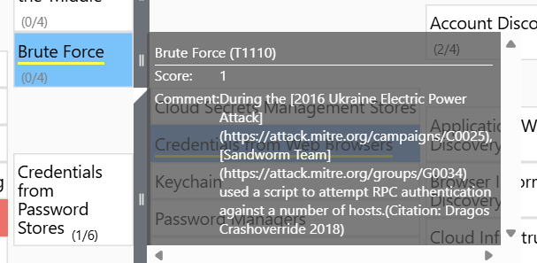

## T3: During the 2016 campaign, the adversary was observed using a VBS script during their operations. What is the name of the VBS file?
- 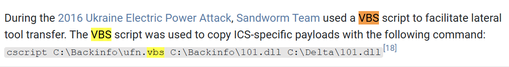

## T4: The APT conducted a major campaign in 2022. The server application was abused to maintain persistence. What is the Mitre Att&ck ID for the persistence technique was used by the group to allow them remote access?
- 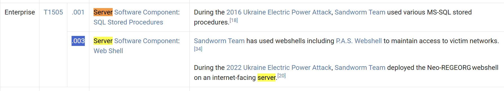

## T5: What is the name of the malware / tool used in question 4?
- It is in the same picture above

## T6: Which SCADA application binary was abused by the group to achieve code execution on SCADA Systems in the same campaign in 2022?
- 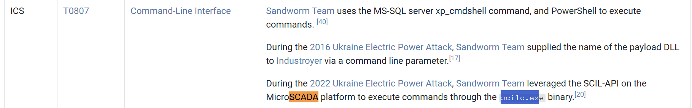

## T7: Identify the full command line associated with the execution of the tool from question 6 to perform actions against substations in the SCADA environment.
- 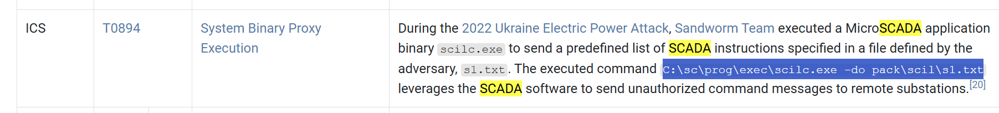

## T8: What malware/tool was used to carry out data destruction in a compromised environment during the same campaign?
- Under Impact in the navigation tab, there is
    - 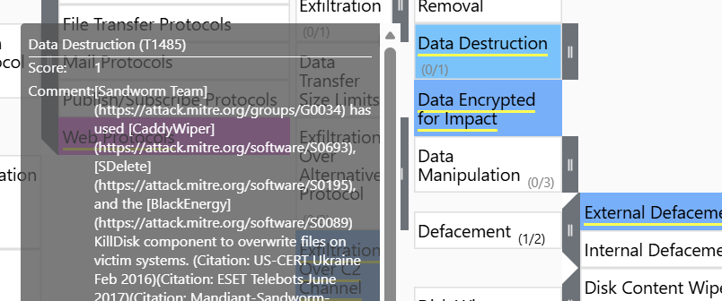

## T9: The malware/tool identified in question 8 also had additional capabilities. What is the Mitre Att&ck ID of the specific technique it could perform in Execution tactic?
- 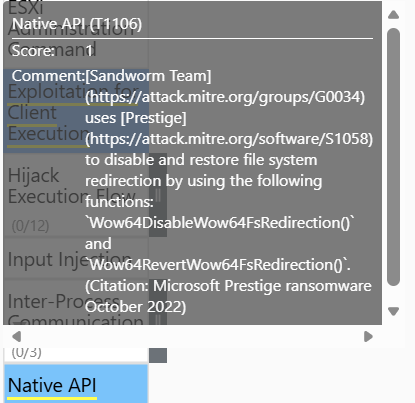

## T10: The Sandworm Team is known to use different tools in their campaigns. They are associated with an auto-spreading malware that acted as a ransomware while having worm-like features. What is the name of this malware?
- 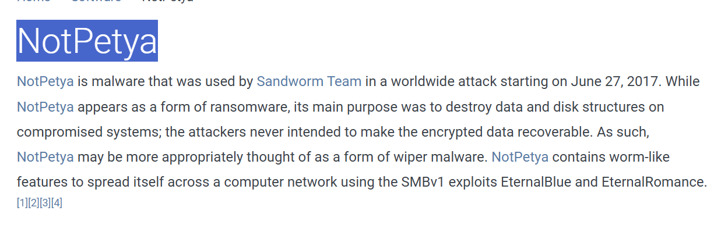

## T11: What was the Microsoft security bulletin ID for the vulnerability that the malware from question 10 used to spread around the world?
- 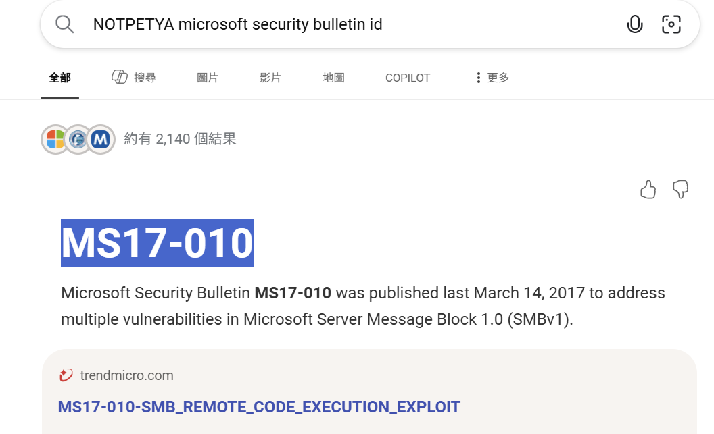

## T12: What is the name of the malware/tool used by the group to target modems?
- 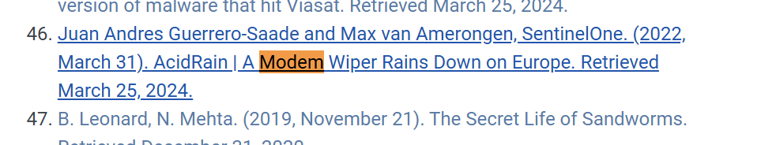

## T13: Threat Actors also use non-standard ports across their infrastructure for Operational-Security purposes. On which port did the Sandworm team reportedly establish their SSH server for listening?
- 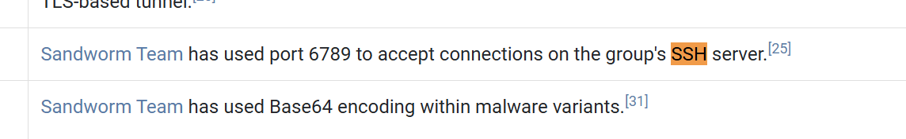

## T14: The Sandworm Team has been assisted by another APT group on various operations. Which specific group is known to have collaborated with them?
- 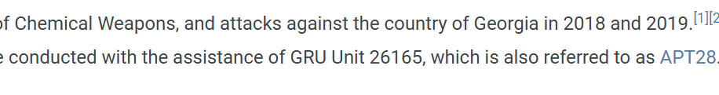

## Sources

- [MITRE ATT&CK — Sandworm Team (G0034)](https://attack.mitre.org/groups/G0034/)
- [MITRE ATT&CK for ICS](https://attack.mitre.org/matrices/ics/)
- [MITRE ATT&CK Navigator](https://mitre-attack.github.io/attack-navigator/)
