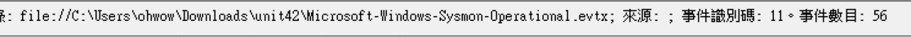
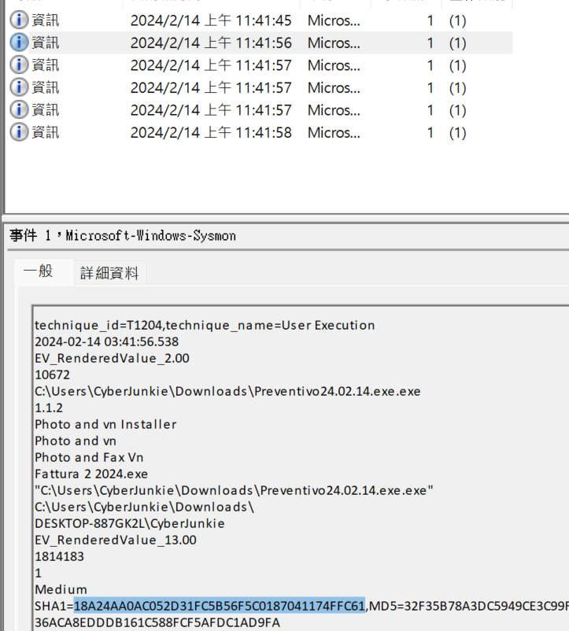
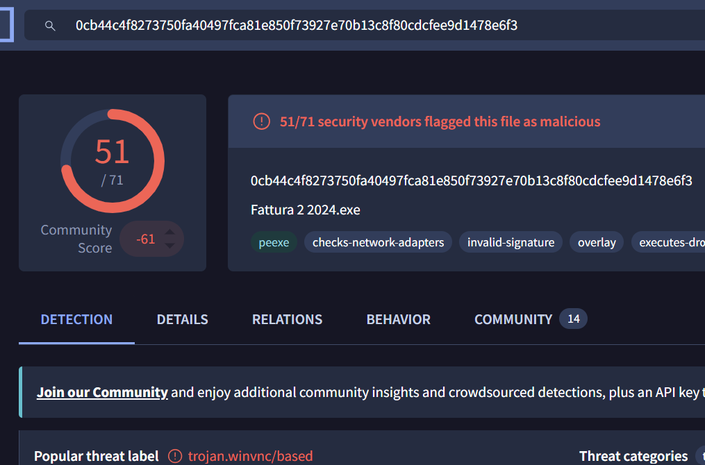
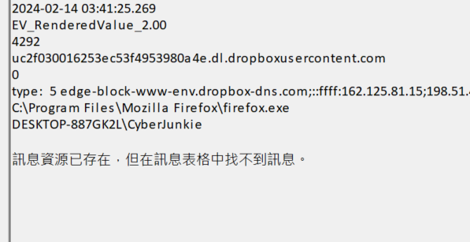
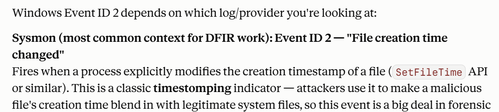
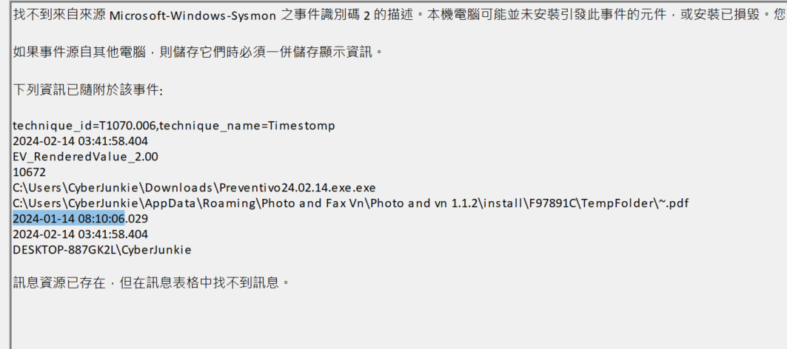
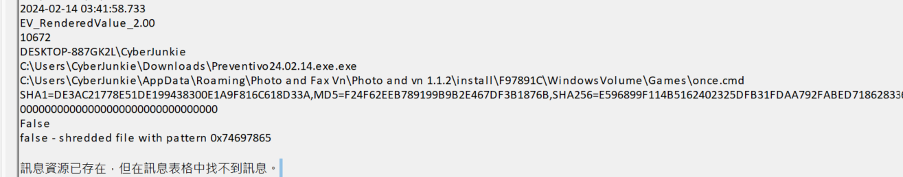
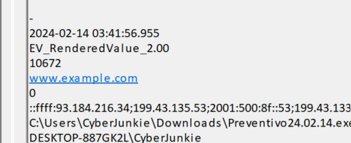

## T1: How many Event logs are there with Event ID 11?
- Very straight forward, just filter for Event ID == 11
    - 

## T2: Whenever a process is created in memory, an event with Event ID 1 is recorded with details such as command line, hashes, process path, parent process path, etc. This information is very useful for an analyst because it allows us to see all programs executed on a system, which means we can spot any malicious processes being executed. What is the malicious process that infected the victim's system?
- Let's also start to filter for Event ID == 1, we see 6 entries
- Let's go thru them one by one and we see that in the 2nd entry there is a file name that is pretty sus, let's paste this to virustotal and check:
    - 
    - 
      VirusTotal on the hash of `Fattura 2 2024.exe`: 51 of 71 vendors flag it, labelled `trojan.winvnc`, the backdoored UltraVNC dropper.
- bingo

## T3: Which Cloud drive was used to distribute the malware?
- Reset the filter and we obviously see dropbox:
    - 

## T4: For many of the files it wrote to disk, the initial malicious file used a defense evasion technique called Time Stomping, where the file creation date is changed to make it appear older and blend in with other files. What was the timestamp changed to for the PDF file?
- Asked claude for what event id == 2 means 
    - 
- So we see that we need to filter for ts
- 

## T5: The malicious file dropped a few files on disk. Where was "once.cmd" created on disk? Please answer with the full path along with the filename.
- This full path is pretty weird but it is correct, we have some ways to do it, i just ctrl+f for `once.cmd`
- 

## T6: The malicious file attempted to reach a dummy domain, most likely to check the internet connection status. What domain name did it try to connect to?
- 
  Sysmon Event 22 (DNS query) from `Preventivo24.02.14.exe`: it looked up `www.example.com`, the dummy domain used as an internet connectivity check. The resolved addresses are listed underneath.
- What i did is just ctrl+f for `www.`

## T7: Which IP address did the malicious process try to reach out to?
- This is pretty simple, just below the previous problem
    - The DNS lookup is Sysmon Event ID 22; the connection that follows is Event ID 3 (network connection) from the same process — the answer is its `DestinationIp`.

## T8: The malicious process terminated itself after infecting the PC with a backdoored variant of UltraVNC. When did the process terminate itself?
- Let's search for "process termination event ID" and we see that it is ID==5, so we filter for it and we only see 1 event, also matching the malicious file.
    - The answer is the `UtcTime` field of that Event ID 5 entry.

## Detection & mitigation

- **Sysmon Event ID 2 is a timestomping alarm.** "A process changed a file creation time" is rare for legitimate software and is exactly how the backdated PDF showed up (T1070.006). Alert on it, especially from processes running out of `Downloads` or `Temp`.
- **Watch delivery from consumer cloud storage.** The dropper came from Dropbox. Flag executables downloaded from personal cloud-storage domains and run directly from the browser download folder.
- **The connectivity check is an IOC too.** Malware resolving a dummy domain (Event 22) right before an outbound connection (Event 3) is a reliable sequence to build a detection on.
- **Start from a maintained Sysmon config** rather than the defaults, so these events are captured in the first place.

### References

- [Microsoft Sysinternals — Sysmon](https://learn.microsoft.com/en-us/sysinternals/downloads/sysmon)
- [MITRE ATT&CK — T1070.006 Timestomp](https://attack.mitre.org/techniques/T1070/006/)
- [sysmon-modular — a maintained Sysmon configuration](https://github.com/olafhartong/sysmon-modular)
