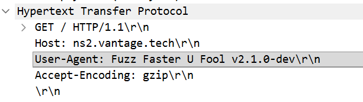
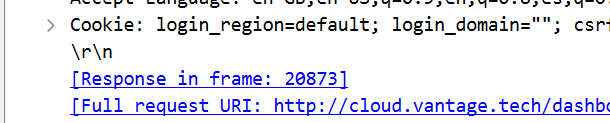

## T1: What tool did the attacker use to fuzz the web server ?
- We know that fuzzing means sending a ton of HTTP requests to try to find routes, so we can apply HTTP filter first. In the first few packets, we can open them and see that under Hypertext Transfer Protocol, there is the User-Agent which tells us the tool.
    - , this is ffuf

## T2: Which subdomain did the attacker discover?
- We see there is a lot of trials to find subdomains, but it all GETs the root of it, only a few successfully GETs /dashboard..., and upon investigating we see that they all have a subdomain of "cloud"
    - 

## T3: How many login attempts did the attacker make before successfully logging in to the dashboard?
- Just see that there are 4 POST request to the login page, so there are 4-1=3 failed attempts.

## T4: When did the attacker download the OpenStack API remote access config file? (UTC)
- The very last packet of the filter `http && ip.src == 117.200.21.26` shows the time

## T5: When did the attacker first interact with the API on controller node? (UTC)
- Same filter: `http && ip.src == 117.200.21.26` and literally the first packet

## T6: What is the project id of the default project accessed by the attacker?
- Pretty straight forward, we see that the attacker failed for some ids, but there is an id that the attacker successfully used over and over again to gain json and csv files

## T7: Which OpenStack service provides authentication and authorization for the OpenStack API?

- Keystone, we change the filter to `http && ip.src == 134.209.71.220`, i.e. source from the controller, and we check for authorization info such as UNAUTHORIZED, we see the service there.

## T8: What is the endpoint URL of the swift service?

- Let's change the filter back once again, and just check the same info of T6

## T9: How many containers were discovered by the attacker?

- 3, following the HTTP stream of `/v1/AUTH_9fb84977ff7c4a0baf0d5dbb57e235c7?format=json` we see below there are 3 containers

## T10: When did the attacker download the sensitive user data file? (UTC)

- In the same filter of the attacker, we see that he/she downloads a user-details.csv, just open that and record the time

## T11: How many user records are in the sensitive user data file?

- We follow the HTTP stream of this extraction, and see the contents of it

## T12: For persistence, the attacker created a new user with admin privileges. What is the username of the new user?

- Same filter, just below we can easily see the name

## T13: What is the password of the new user?

- A bit trickier but not that bad, we just have to analyze that when an account is created it must go through some api endpoint, and it seems that it is `/identity/v3/users/`, so make the filter as `http.request.uri == "/identity/v3/users"` and then we follow the POST request from the attacker to see that the password is in there for the new user

## T14: What is MITRE tactic id of the technique in task 12?

- Google it!
    - Making a new account is technique T1136 (Create Account), which sits under the **Persistence** tactic — note the question wants the *tactic* ID (`TA...`), not the technique ID.

## Detection & mitigation

- **Everything was readable because it was plain HTTP.** The login, API tokens and even the new user's password were in the capture. Put the dashboard and every API endpoint behind TLS.
- **Don't expose the dashboard and APIs to the internet.** Restrict Horizon, Keystone and Swift to a management network or VPN, rate-limit logins, and require MFA — three failures followed by a success is a textbook brute force.
- **Alert on identity changes.** Creating a user and granting it admin (T1136) is the persistence step; Keystone's audit middleware (CADF events) can raise it in real time.
- **Lock down object storage.** The user-data CSV was sitting in a container the compromised project could list and download. Apply container ACLs and keep sensitive exports out of shared projects.

### References

- [OpenStack Security Guide](https://docs.openstack.org/security-guide/)
- [MITRE ATT&CK — T1136 Create Account](https://attack.mitre.org/techniques/T1136/)
- [MITRE ATT&CK — T1110 Brute Force](https://attack.mitre.org/techniques/T1110/)
